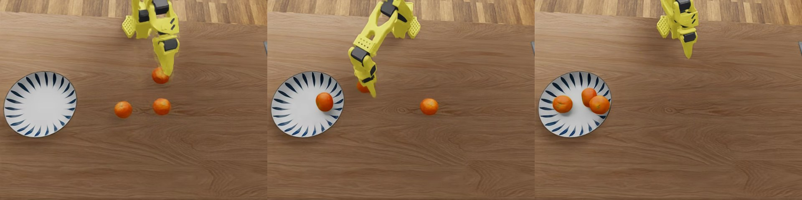

# Flow

Ritwik. Updated 20 Nov 2026.

This folder is the work: dataset, model, simulator notes, and the eval. The scoreboard is in the root [README](../README.md). The order of what comes next is in [project_flow.md](../project_flow.md).

## Baseline

| Policy | Grasp | Place | Task complete | Gripper |
|---|---|---|---|---|
| Pretrained SmolVLA | 0/3 | 0/3 | 0/3 | about -10 to 0 deg |
| Random | 0/3 | 0/3 | 0/3 | wide swing, no grasp |

Headless, seed 1000, 60 seconds, three episodes. Script:

```bash
cd leisaac
python ../flow/04_rollout/eval_rollout.py \
    --policy pretrained \
    --episodes 3 --seed 1000 --episode_length_s 60 \
    --headless --enable_cameras --device cuda:0
```

`--policy random` does not need the policy server. Pretrained SmolVLA does. Start `start_policy_server.py` first. After the HPC run, point the same script at the new checkpoint and write clips under `videos/finetune/`.

Rows: [04_rollout/report/eval_metrics.csv](04_rollout/report/eval_metrics.csv).
Clips: [../videos](../videos/README.md).

## Settings

| Setting | Value |
|---|---|
| Instruction | `Grab orange and place into plate` |
| Cameras | front → `camera1`, wrist → `camera2` |
| Joints | shoulder pan, shoulder lift, elbow flex, wrist flex, wrist roll, gripper |
| Horizon | 16 |
| Scene | `LeIsaac-SO101-PickOrange-Direct-v0` |
| Simulator | Isaac Sim 5.1.0 on the lab RTX 4090. Headless for scoring. |

## Dataset

```bash
python flow/01_dataset_exploration/explore_dataset.py
```

60 episodes, 36,293 frames, 30 fps, 480×640, six joint actions. Task string: `Grab orange and place into plate`.



*Start: three oranges on the table, arm at rest. Middle: one orange already in the plate. End: all three in the plate, arm back at rest.*

Full writeup: [dataset report](01_dataset_exploration/report/dataset_report.md).

## Model

```bash
python flow/02_model_exploration/contract_test.py
```

`lerobot/smolvla_base`, 450M parameters. One real frame goes in, six joint numbers come out, in our order. The numbers are close to zero. The demonstration on that frame is in the tens of degrees. That is the starting point.

Full writeup: [model report](02_model_exploration/report/contract_test_report.md).

## Older notes

`03_sim_setup/RUNBOOK.md` and `04_rollout/RUNBOOK.md` are the RunPod plan from October. I did not use that machine. The 4090 notes are in `Lab_log.md`.
