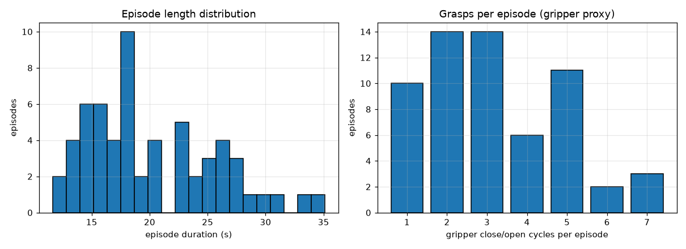
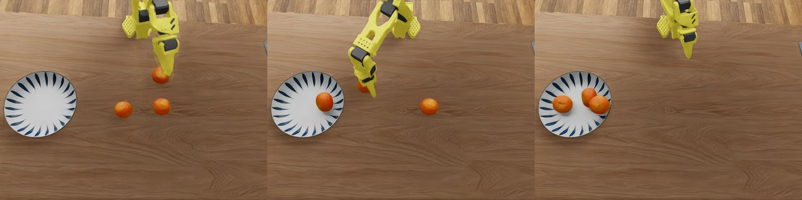
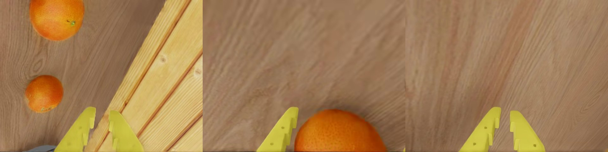
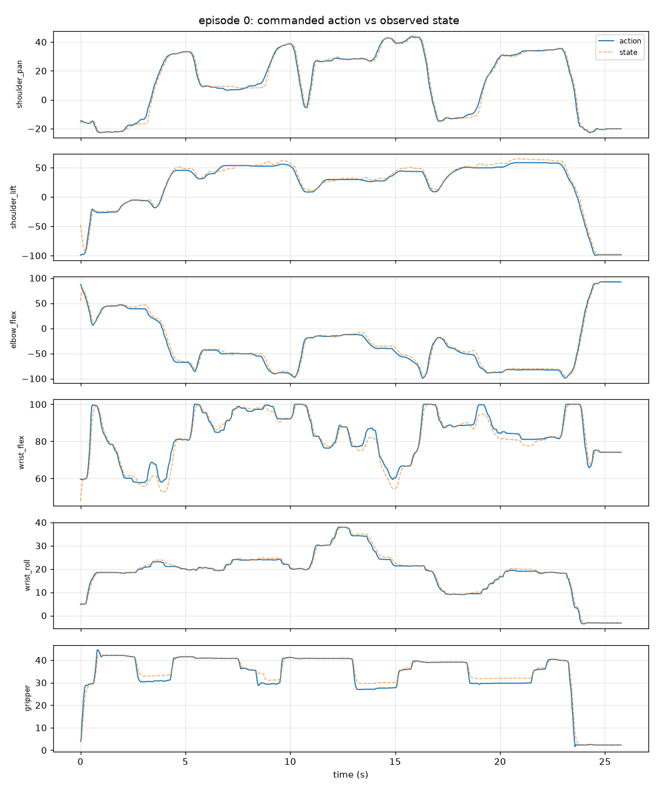
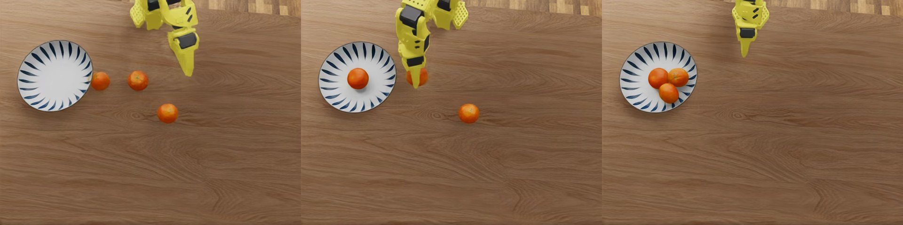
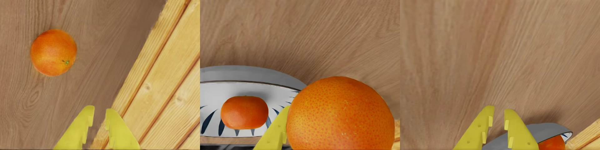
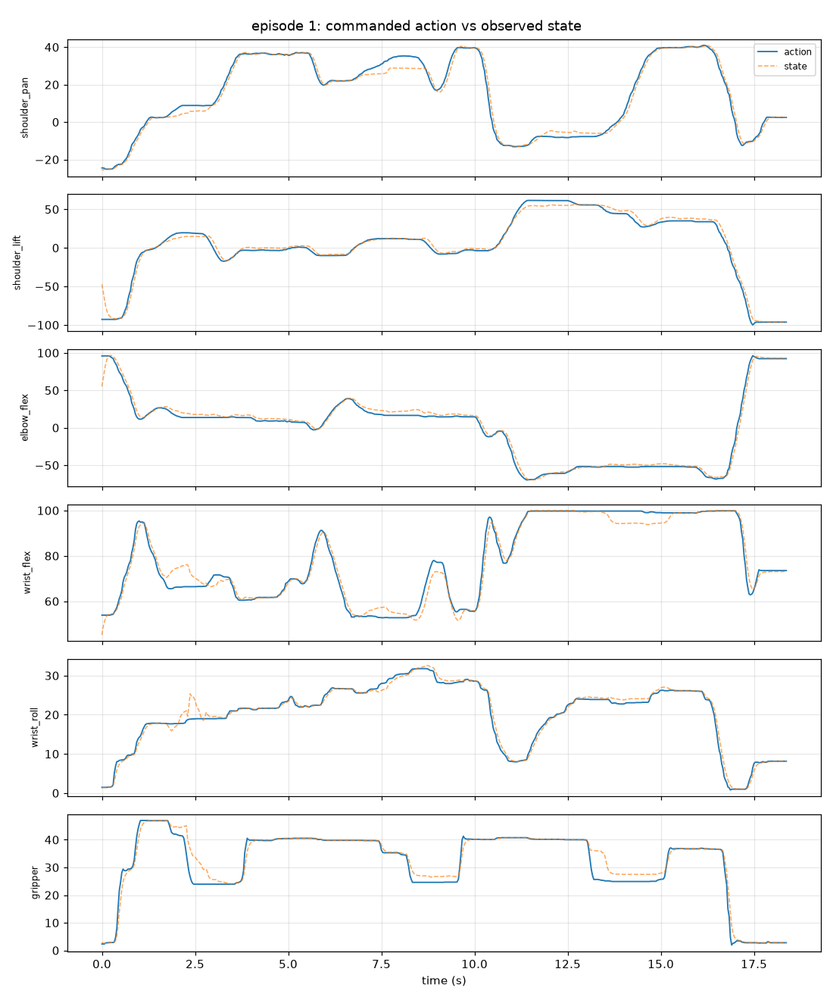
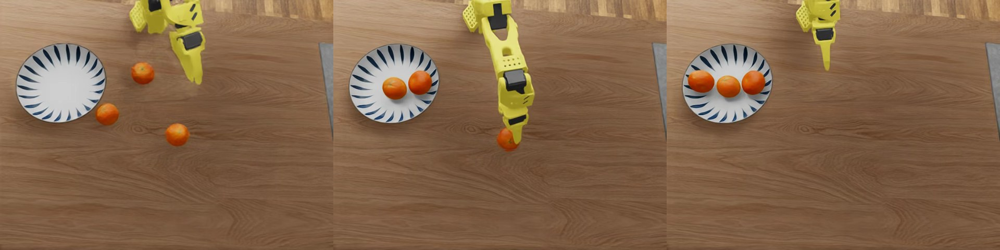
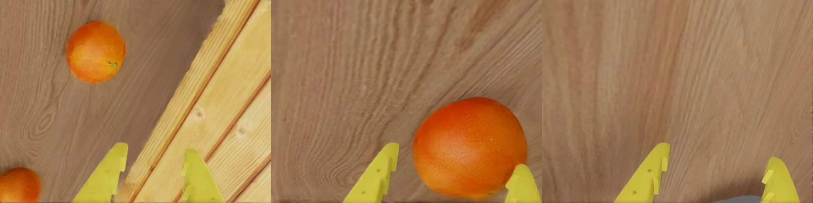
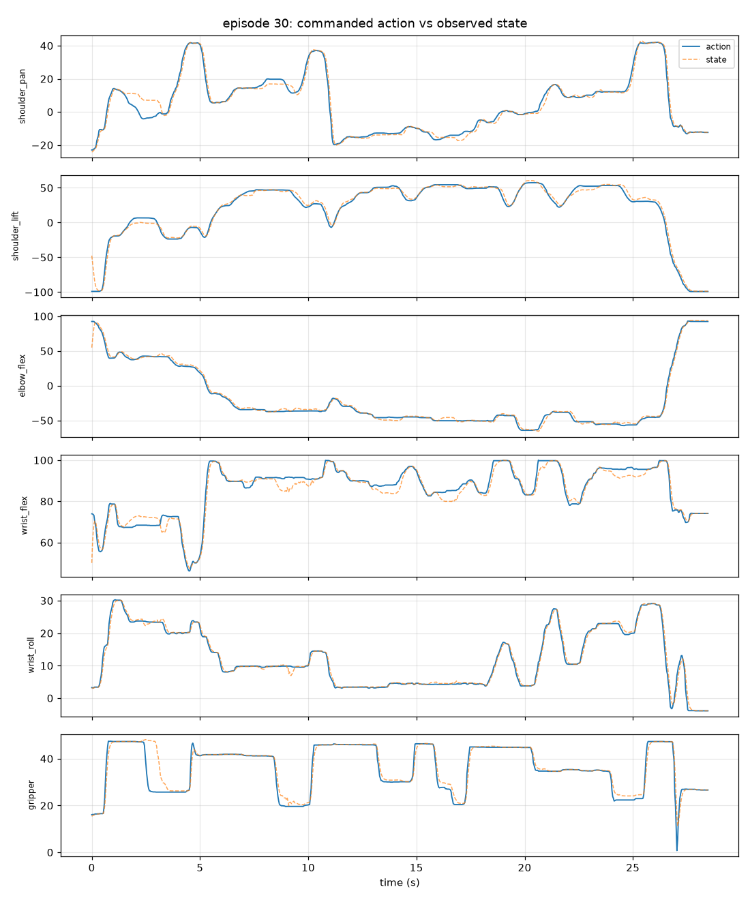

# Dataset exploration: `LightwheelAI/leisaac-pick-orange`

Ritwik. Generated by `explore_dataset.py`. Format checks: **7/7**.

I pulled the dataset we are training and evaluating on and checked that the action
format and the two cameras match what the model and the Isaac scene need.

## Format checks

| Property | Expected | Found | Result |
|---|---|---|---|
| robot_type | `so101_follower` | `so101_follower` | PASS |
| fps | `30` | `30` | PASS |
| action shape | `[6]` | `[6]` | PASS |
| action joint order | `6 SO-101 joints` | `['shoulder_pan.pos', 'shoulder_lift.pos', 'elbow_flex.pos', 'wrist_flex.pos', 'wrist_roll.pos', 'gripper.pos']` | PASS |
| state joint order | `same as action` | `['shoulder_pan.pos', 'shoulder_lift.pos', 'elbow_flex.pos', 'wrist_flex.pos', 'wrist_roll.pos', 'gripper.pos']` | PASS |
| camera keys | `front + wrist` | `['observation.images.front', 'observation.images.wrist']` | PASS |
| camera resolution | `480x640x3` | `front=[480, 640, 3] wrist=[480, 640, 3]` | PASS |

## Summary

| Field | Value |
|---|---|
| codebase_version | `v2.1` |
| robot_type | `so101_follower` |
| episodes | 60 |
| frames | 36,293 |
| videos | 120 (60 episodes × 2 cameras) |
| fps | 30 |
| video codec | `av1` |
| total duration | 20.2 min |
| tasks | 1 |
| task string | `Grab orange and place into plate` |

That task string is the instruction we pass to the model.

### Episode lengths

| Stat | Frames | Seconds |
|---|---|---|
| min | 349 | 11.6 |
| median | 552 | 18.4 |
| mean | 605 | 20.2 |
| max | 1053 | 35.1 |

A 120 second evaluation episode is plenty of room relative to these demonstrations.

### Gripper cycles per episode

I counted how many times the gripper closes and opens in each episode, from the gripper
channel in the action. Median is 3, which matches the three oranges in the task.

| Gripper cycles | Episodes |
|---|---|
| 1 | 10 |
| 2 | 14 |
| 3 | 14 |
| 4 | 6 |
| 5 | 11 |
| 6 | 2 |
| 7 | 3 |

## The task

Pick three oranges, put them on the plate, then return the arm to rest. That is what the
videos show and what the gripper cycles line up with. We score per orange, so the
denominator is three per episode.

## Figures

*Left: how long the 60 demonstrations run. Most sit around 18 seconds, shortest is about
12, longest about 35. Right: gripper close/open cycles per episode. Median is 3, one
cycle per orange.*

*Episode 0, front camera, three frames: start, middle, end. At the start the three
oranges are on the table and the arm is at rest. Midway through, one orange is already
in the plate and the gripper is on another. At the end all three are in the plate and
the arm is back at rest. This is `observation.images.front`.*

*Episode 0, wrist camera, same three moments. This is the close-up the policy uses to
line the gripper up on an orange. This is `observation.images.wrist`.*

*Episode 0, the six joints over time. Solid line is the commanded action, dashed is the
joint position the arm actually reached. They track each other closely. The gripper
row at the bottom is the three grasp and release cycles, and the last couple of seconds
on shoulder lift and elbow flex is the return to rest.*

*Episode 1, front camera, start / middle / end. Same task, slightly different orange
layout on the table. Three in, three in the plate, arm back to rest.*

*Episode 1, wrist camera, same three moments.*

*Episode 1, commanded action vs observed joint state for all six joints. Same pattern
as episode 0: the two lines sit on top of each other, three gripper cycles, then rest.*

*Episode 30, front camera, start / middle / end. I picked a later episode as well so we
are not only looking at the first two. Same three-orange task.*

*Episode 30, wrist camera, same three moments.*

*Episode 30, six joints over time. Commanded action and observed state still track.
Gripper row shows the picks, then the arm returns to rest.*
