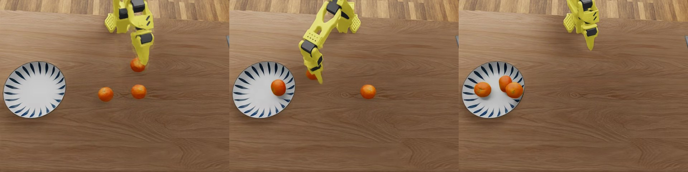
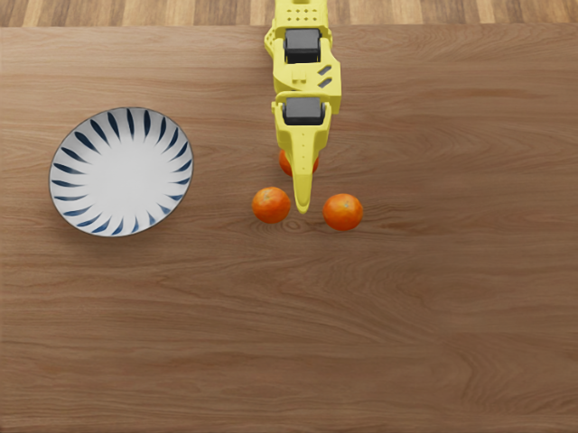
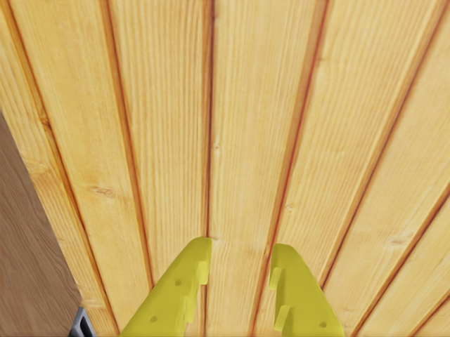
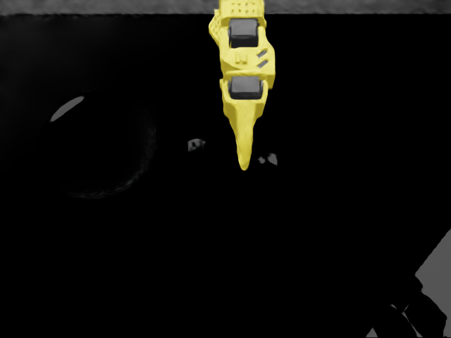

# Phase 1

Ritwik. Updated 18 Nov 2026.

Dataset, model, simulator, and one pretrained rollout. The first three tracks were
already done on my laptop. On 18 Nov I ran the last two on a RunPod A40.

Phases 2 and 3 are the eval script and the fine-tune. Details are in
[`../project_phases.md`](../project_phases.md).

| Track | GPU? | Status |
|---|---|---|
| [01 dataset](01_dataset_exploration/report/dataset_report.md) | No | Done, on my laptop |
| [02 model](02_model_exploration/report/contract_test_report.md) | No | Done, on my laptop |
| [03 simulator](03_sim_setup/RUNBOOK.md) | Yes | Done, headless frames on the pod |
| [04 one rollout](04_rollout/RUNBOOK.md) | Yes | Done. Pretrained SmolVLA, 0/5 |

`feature/ritwik_workflow` does not have this pod run. I left that branch as it was so
I can pull it on the campus RTX 4090 and keep going there. This writeup is on
`feature/baselinework_runpod`.

---

## Settings we use from here on

These came out of tracks 1 and 2. Tracks 3 and 4 use them as is.

| Setting | Value |
|---|---|
| Instruction | `Grab orange and place into plate` |
| Camera mapping | `front` → `camera1`, `wrist` → `camera2`. Leave the third camera unused. |
| Joint order | shoulder pan, shoulder lift, elbow flex, wrist flex, wrist roll, gripper |
| Action horizon | 16 for the first rollout. Sweep 1 to 50 later. The model returns at most 50. |
| Scene | `LeIsaac-SO101-PickOrange-Direct-v0` |
| Episode length | 120 s at 30 Hz |
| Simulator | Isaac Sim 4.5.0, headless, cameras saved to disk |

## Dataset

```bash
python phase1/01_dataset_exploration/explore_dataset.py
```

60 episodes of the SO-101 picking three oranges into a plate. 36,293 frames at 30 fps,
front and wrist cameras at 480×640, six joint actions.

The task string in the dataset is `Grab orange and place into plate`. That is the
instruction we pass to the model.



*Episode 0 from the front camera. Left is the start: three oranges on the table and the
arm at rest. Middle is mid-episode, one orange already in the plate. Right is the end:
all three in the plate and the arm back at rest.*

Full writeup with every figure:
[dataset report](01_dataset_exploration/report/dataset_report.md)

## Model

```bash
python phase1/02_model_exploration/contract_test.py
```

I loaded `lerobot/smolvla_base` (450M parameters) and ran one real frame from the
dataset through it. It returns six numbers in our joint order. That is what we needed
from this step: the pretrained model loads and talks to this arm.

The numbers themselves are close to zero on every joint, while the demonstration on that
frame is in the tens of degrees. That is the starting point before fine-tuning.

Full writeup: [model report](02_model_exploration/report/contract_test_report.md)

## What I ran on the pod

The pod was a plain Ubuntu 22.04 A40, not the NGC Isaac image. Driver `570.211.01`,
`nvidia-smi` CUDA 12.8, 46 GB of GPU memory. There is no Docker inside the pod, so I
installed Isaac Sim 4.5.0 from NVIDIA's pip index. No NGC key. Isaac Lab is v2.1.1.
LeIsaac is commit `493f91c`, the last commit that still documents Isaac 4.5. Current
LeIsaac wants Isaac 5.1, so I did not use that.

Isaac Lab's installer replaced the PyTorch I had pinned and left `torch 2.7.0+cu128`.
That is what the simulator actually ran. The laptop model check is still LeRobot
0.6.1. The policy server on the pod is LeRobot 0.3.3, which is the version LeIsaac's
client was generated against. Those two do not share a virtualenv.

### Simulator

Headless, cameras to disk. I loaded `LeIsaac-SO101-PickOrange-v0`, stepped it, and
saved one front frame and one wrist frame.



*Front camera. The SO-101, the plate, and three oranges are in the frame.*



*Wrist camera. The gripper is in frame, so this camera is rendering too.*

I did not get a live WebRTC picture. The client wants TCP `49100` and UDP `47998`.
This pod publishes those as public TCP `22077` and UDP `22078`, and Isaac 4.5 cannot
advertise the public ports. The viewer is still pending. The frames above are the
proof that the scene rendered.

### Rollout

Five episodes, seed 1000, horizon 16, 120 seconds each, instruction
`Grab orange and place into plate`. Scene `LeIsaac-SO101-PickOrange-Direct-v0`.
Cameras go out as `camera1` and `camera2`. I left `camera3` out.

The current `lerobot/smolvla_base` files on the Hub no longer carry the normalization
stats in the place LeRobot 0.3.3 loads. A first attempt returned an all-zero action
because those buffers were still infinity. I reloaded the 24 Jun 2025 revision of the
same checkpoint, which still has the pooled SO-100 stats, and kept the camera names
from the current config. After that the first action was six real joint targets, not
zeros.

| Episode | Oranges placed | Success | Why it ended |
|---|---|---|---|
| 1 | 0 | no | time out, 120 s |
| 2 | 0 | no | time out, 120 s |
| 3 | 0 | no | time out, 120 s |
| 4 | 0 | no | time out, 120 s |
| 5 | 0 | no | time out, 120 s |

**0/5.** The arm moved. Nothing landed on the plate. That is the pretrained baseline,
before any fine-tune. The table is
[rollout_results.csv](04_rollout/report/rollout_results.csv).



*Episode 1, front camera at the start. Middle and end frames are next to it in
`04_rollout/report/frames/pretrained/episode_01/`.*

I started a random-action pass and stopped it. Random joint targets made the physics
step crawl, and I did not get a finished episode, so there is no random baseline yet.

## What is not done

- WebRTC. No one has seen a live picture from this pod.
- The eval script: more seeds, per-orange rate, 95% confidence interval.
- Fine-tuning. That stays on the HPC H100 or A100, then the same eval scores the new
  checkpoint.
- The campus RTX 4090 (`10.31.82.76`) can run this stack, but Isaac is not installed
  there. The machine my professor wrote down, `10.31.82.102`, is a different computer.
  I have not logged into it.

## Rerunning the laptop tracks

```bash
uv venv --python 3.12 .venv
uv pip install --python .venv/bin/python "lerobot[smolvla]==0.6.1" pandas pyarrow matplotlib
.venv/bin/python phase1/01_dataset_exploration/explore_dataset.py
.venv/bin/python phase1/02_model_exploration/contract_test.py
```

Versions I used are in [`requirements-phase1.txt`](requirements-phase1.txt). Both scripts
ran on an M-series Mac, no GPU.
